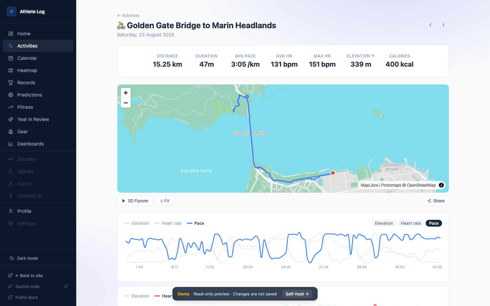
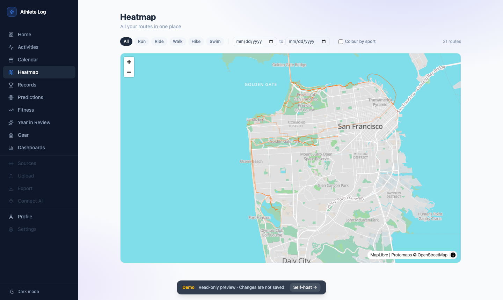
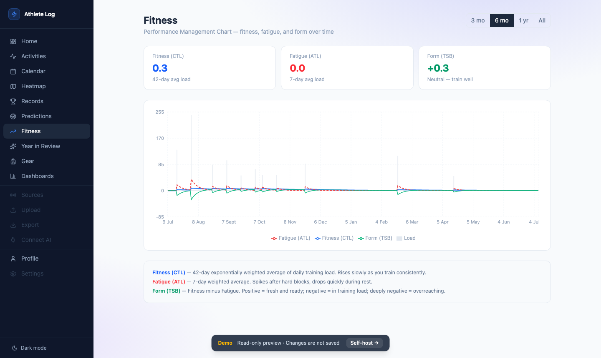

# Features

## Activity detail

Each activity page shows everything about a single workout.

### Stats header

Distance · moving time · average pace · average & max HR · elevation gain · **calories** — all unit-aware (switch between metric and imperial in Settings).

A **weather chip** appears when the activity has GPS data: temperature, wind speed, and a description fetched once from the Open-Meteo archive API and cached in the database.

### Route map

GPS track rendered on a full-width map with start (green) and finish (red) markers. Choose from multiple map styles:

- **OSM** — OpenStreetMap raster tiles
- **Protomaps Light / Dark / White / Greyscale** — vector tiles served from your own or a hosted Protomaps key; fast and offline-capable

Hover any chart point to move a crosshair marker to that exact position on the map.

### Charts

Up to four simultaneous Recharts panels. Available metrics: **pace**, **heart rate**, **elevation**, **cadence**. A metric picker above each chart lets you swap without reloading.

### Auto splits

A per-km (or per-mile) split table computed directly from raw GPS samples — no device lap button required. Each split shows pace, average HR, and elevation delta. Toggle between km and mile splits with a single button.

### Comparable efforts

A "Similar routes" card appears when two or more activities share approximately the same route (bounding box centroid within ~1 km, distance within ±20%). The table shows date, distance, pace, HR, and a "vs your best" pace delta coloured green or red.

### Notes

A free-text notes field sits below the stats. Type anything — race report, how your legs felt, conditions — and it saves automatically when you click away. Notes are searchable and persist across syncs.

### Tags

Attach key/value tags to any activity (e.g. `surface: trail`, `effort: easy`). Tags are displayed as chips and can be added or removed at any time without affecting synced data.

### 3D flyover

Click **3D Flyover** on any activity with GPS data. The map tilts to 62°, follows the route at 15.5× zoom with terrain exaggeration, and animates the camera along the path. Speed is adjustable (0.5×, 1×, 2×). Stop at any point — the map returns to a flat bird's-eye view.

Requires a Protomaps key (vector tiles provide the terrain layer). Falls back gracefully on raster tile styles.

### Share card

Click **Share** to open the share card modal. Choose from three aspect ratios (16:9 landscape, 9:16 portrait, 1:1 square) and three themes (dark, light, transparent). The card includes the route map, key stats, and activity name — export as PNG with one click.

### Laps table

Per-lap summary imported from your device: index, distance, pace, average HR.

### Gear

Assign shoes, bikes, or other equipment directly from the activity page. Assignments appear immediately in the Gear page totals.

---

## Heatmap

Every GPS route overlaid on one map. Dense areas appear brighter due to overlapping semi-transparent lines.

- **Sport filter** — isolate runs, rides, or any single sport type
- **Date range** — narrow to a specific period
- **Map style** — all the same styles as the activity detail map

The heatmap GeoJSON is computed once and cached in memory; re-cached whenever new activities arrive.

---

## Training Calendar

Monthly grid showing all activities. Spot training consistency and rest days at a glance.

- Each day cell is coloured by sport type; height scales with total distance
- Click a day to expand and see all activities logged that day
- Navigate month by month
- **Streak overlay** — current and best streaks shown in the header

---

## Fitness (Performance Management Chart)

`/fitness` — the single most-requested feature by structured-training athletes.

Three lines plotted over time:

| Line | Colour | Meaning |
|---|---|---|
| **CTL** | Blue | Chronic Training Load — 42-day EWMA of daily TRIMP (proxy for fitness) |
| **ATL** | Red | Acute Training Load — 7-day EWMA (proxy for fatigue) |
| **TSB** | Green | Training Stress Balance = CTL − ATL (positive = fresh, negative = fatigued) |

**TRIMP formula**: `duration_min × hr_ratio × e^(1.92 × hr_ratio)` where `hr_ratio = avg_hr / hr_max`. Falls back to `duration_min × 1.0` when HR data is absent.

Set your **max heart rate** in Settings to enable accurate TRIMP computation.

---

## Personal Records

Auto-detects your best efforts at standard distances using a sliding window over GPS samples:

| Distance | |
|---|---|
| 400 m | 1 km |
| 1 mile | 5 km |
| 10 km | 15 km |
| Half Marathon | Marathon |

For each distance: best time, pace, date set, link to the activity. The progression chart shows how each PR has evolved over time.

---

## Year in Review

`/review` — auto-generated annual summary, like "Year in Sport Wrapped".

- **Hero stat** — total distance for the year in large type
- **Month bar chart** — distance by month
- **Stat grid** — total time, elevation, activity count
- **Biggest activity** — the single longest activity of the year
- **Most-used gear** — the item with the most distance assigned
- **Sport breakdown** — donut chart by sport type

Use the year picker to navigate between years.

---

## Dashboards

Build custom dashboards from a library of widgets. Each dashboard has its own drag-and-resize grid.

### Available widgets

| Widget | Description |
|---|---|
| **Stat card** | Single metric (distance, activities, or time) for a chosen period |
| **Bar chart** | Any metric over time, grouped by day / week / month |
| **Line chart** | Pace or HR trend |
| **Donut** | Sport type breakdown by distance |
| **Activity feed** | Scrollable list of recent activities |
| **Eddington number** | Largest N where you have done ≥ N activities of ≥ N km |
| **Personal record** | Best time at a chosen distance |

### Managing dashboards

- **Create** — click "Create dashboard", give it a name
- **Add widget** — click "+ Add widget", choose type and configure
- **Rearrange** — drag widgets; resize from the bottom-right corner
- **Edit widget** — click the ⚙ icon to change metric, period, or filter
- **Delete** — hover a widget for the × button

---

## Gear

Track your equipment and how much distance you've put on each item.

### Adding gear

1. Open the **Gear** page → click **Add gear**
2. Fill in name, type (shoe / bike / watch / other), brand/model, purchase date
3. Set a **distance alert** in km — a warning appears when the total crosses it

### Assigning gear to activities

Open any activity detail page. The stats section has a gear row with an **+ Add gear** button. Check the items you used and save. Totals update immediately.

### Retiring gear

Click the retire button on any item. Retired gear is hidden from the assignment picker but its history is preserved.

---

## Export

Download a TCX zip of your activities for importing into Garmin Connect, TrainingPeaks, or other tools.

1. Open the **Export** page
2. Optionally set a date range and sport type filter
3. Click **Export** — a background job packages the files
4. Once complete, click **Download**

Export jobs persist across restarts. Queue multiple exports and download later.

---

## Settings

| Setting | Description |
|---|---|
| **Strava credentials** | Client ID and secret for Strava OAuth (can also be set via `.env`) |
| **Protomaps API key** | For vector tile map styles (free tier available at protomaps.com) |
| **Map style** | Default map style for all maps |
| **Route colour** | Colour of the GPS track |
| **Max heart rate** | Used for TRIMP / CTL / ATL calculation; rule of thumb: 220 − your age |
| **Units** | Metric (km, m) or Imperial (mi, ft, mph) |
| **Password protection** | Enable a bcrypt-hashed password gate for the entire app — recommended when exposing beyond localhost |
