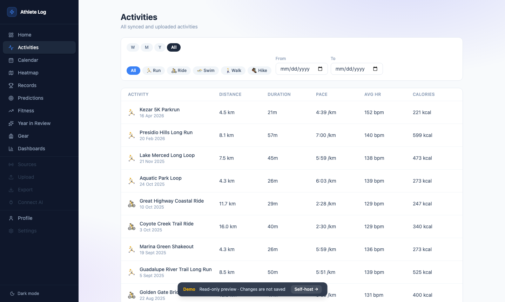

# Athlete Log

<div class="hero" markdown>

**Your fitness data, stored locally.**  
No subscription. No cloud lock-in. No data mining.

[Get started in 3 commands →](setup.md){ .md-button .md-button--primary }
[See all features →](features.md){ .md-button }

</div>



---

## Why local-first?

Every popular fitness platform — Strava, Garmin Connect, Nike Run Club — stores your data on their servers. When they raise prices, sunset features, or shut down, you lose access to years of training history.

Athlete Log runs **on your own hardware**. A Raspberry Pi 4, a Synology NAS, or just your laptop. Your activities, your PRs, and your route maps stay under your control.

---

## What you get

### Performance analytics that rival premium subscriptions

=== "Performance Management Chart"

    CTL (fitness), ATL (fatigue), and TSB (form) plotted over time using the Banister TRIMP formula.
    The same metrics serious athletes used to pay $80/year for on Strava — free and local.

=== "Streak tracking"

    Current and all-time longest activity streaks by day and by week.
    Displayed on the training calendar so gaps are impossible to miss.

=== "Year in Review"

    Auto-generated annual summary: total distance, time, and elevation;
    best month; biggest single activity; most-used gear; new PRs set.

=== "Comparable efforts"

    Previous times on the same route, ranked by pace.
    Know immediately whether today's loop was faster or slower than last Tuesday's.

### Rich activity detail

- **GPS map** with multiple styles (OpenStreetMap and Protomaps vector tiles)
- **Four live charts** — pace, heart rate, elevation, cadence — with hover-to-map marker sync
- **Auto splits** — per-km or per-mile split table computed from raw GPS samples (no laps required)
- **Weather chip** — temperature, wind, and conditions at the exact time of your activity
- **Gear assignments** — tag which shoes or bike you used; mileage tracked automatically

### Everything else

| Feature | Description |
|---|---|
| **Heatmap** | Every GPS route overlaid on one map — see your favourite roads and trails |
| **Training calendar** | Monthly grid coloured by sport; click any day to expand activities |
| **Personal records** | Auto-detected best efforts from 400 m to marathon, with progression charts |
| **Dashboards** | Custom drag-and-resize widget grids (stat cards, charts, Eddington number…) |
| **Gear tracking** | Distance per item, distance alerts, retirement flow |
| **Export** | TCX zip of any date range, importable to Garmin / TrainingPeaks |
| **Imperial & metric** | Toggle globally, persisted per browser |

---

## Data sources

```
FIT / GPX / TCX ──upload► drag-and-drop, any device, deduped by SHA-256
Watched folder ──auto───► monitor a local path; picks up Garmin Express files
Nike Run Club  ──token──► full activity history
Strava         ──OAuth──► requires Strava Premium subscription
```

**No Strava subscription?** Plug in your Garmin, Wahoo, or any other GPS watch — the Watched Folder source picks up FIT files automatically as Garmin Express copies them. Or use Strava's [GDPR bulk export](https://support.strava.com/hc/en-us/articles/216918437) to migrate your full history as FIT/GPX files.

Athlete Log never touches your data without your instruction. Tokens are stored in your own database. Nothing is ever sent to any third party beyond the sources you explicitly connect.

---

## Quick start

Requires [Docker](https://docs.docker.com/get-docker/).

```sh
git clone https://github.com/nowakkuba99/athlete-log
cd athlete-log
docker compose up
```

Open **[http://127.0.0.1:8080](http://127.0.0.1:8080)** once the stack is up.

That's it. SQLite, migrations, the Go API, and the React UI all start together in one command.

→ See [Setup](setup.md) for configuration, development mode, and Make targets.  
→ See [Connecting sources](sources.md) for Strava OAuth, NRC tokens, and file uploads.
